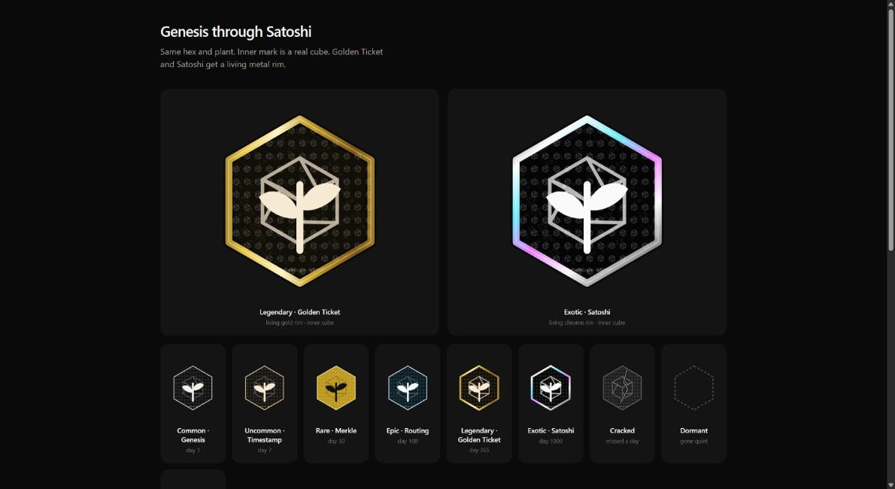

# gm badge for Saito

Say **gm** in Red Square once a day. Earn a badge NFT that grows with your streak.
Nobody can buy it. Anyone can verify it.



- **Earned, never sold.** Your first on-chain gm mints a `gm` NFT to your wallet with a sequential serial. Earlier is lower.
- **Ranks from your streak:** Common Genesis (1), Uncommon Timestamp (7), Rare Merkle (30), Epic Routing (100), Legendary Golden Ticket (365), Exotic Satoshi (1000). Miss a day and the cube cracks for 24h, then restarts. Lifetime gms never reset.
- **The locked hex.** Every rank is the same black hex with the Saito impossible cube inside. Rarity shows in the material: paper, parchment, gold, ice, then a living gold rim at Golden Ticket and a living chrome rim at Satoshi.
- **Everywhere.** The badge is drawn next to your name in Red Square, Chat, Arcade and profiles.
- **Secured.** Wallets verify the issuer key and serial on the NFT itself and flag anything else as counterfeit. The art carries a Saito-cube micro matrix, a micro-text ring and a micro-printed serial line.
- **Self-sustaining.** Each badge holds a 1 SAITO deposit so it pays its own ATR rent.

## Layout

```
mods/gmbadge/      the Saito module (drop into saito/node/mods/)
tests/gmbadge/     unit tests for the streak rules and SVG renderer
docs/design.md     design decisions, gotchas, what is verified and what is not
docs/research/     deep research on Saito + NFTs that led here
```

## Install into a Saito node

```bash
git clone https://github.com/SaitoTech/saito && cd saito/node && npm install
cp -r /path/to/saito-gm-badge/mods/gmbadge mods/gmbadge
# add 'gmbadge/gmbadge.js' (and 'league/league.js') to both lists in config/modules.config.js
bash scripts/compile nuke && npm run dev
# http://localhost:12101/gmbadge
```

The node's wallet is the badge issuer. See `mods/gmbadge/DEPLOY.md` for mainnet.

## Test

```bash
npm test
```

## Status

Verified end to end on a local dev chain. Submitted upstream as
[SaitoTech/saito#719](https://github.com/SaitoTech/saito/pull/719).
